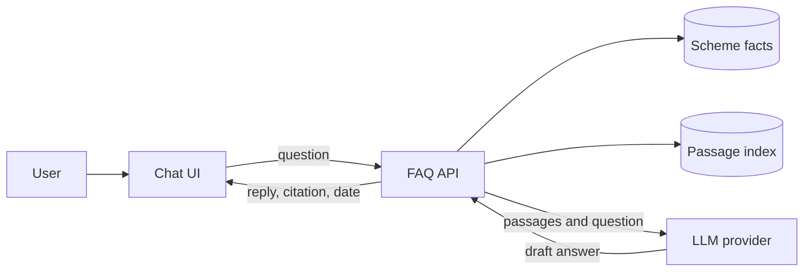
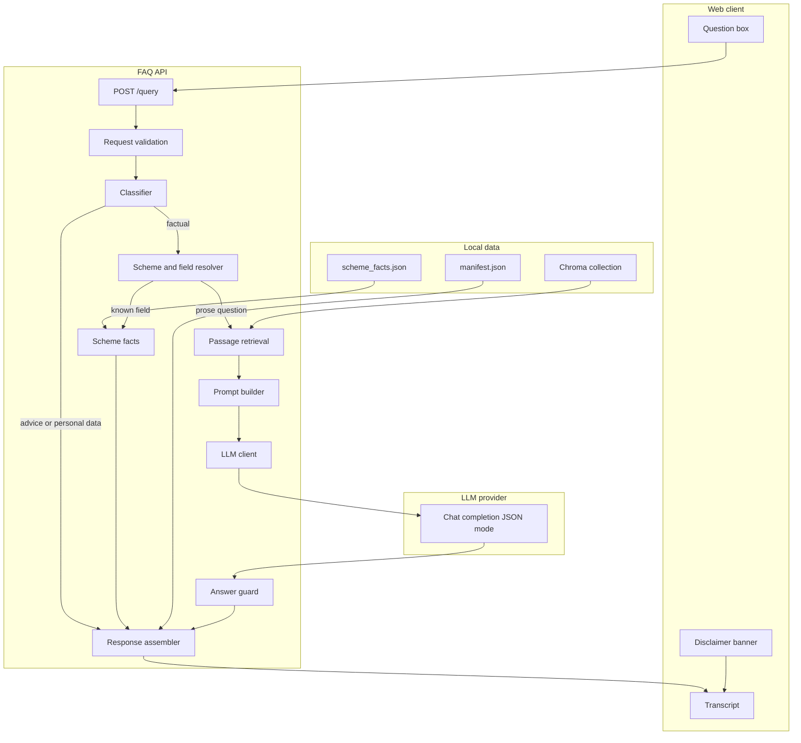
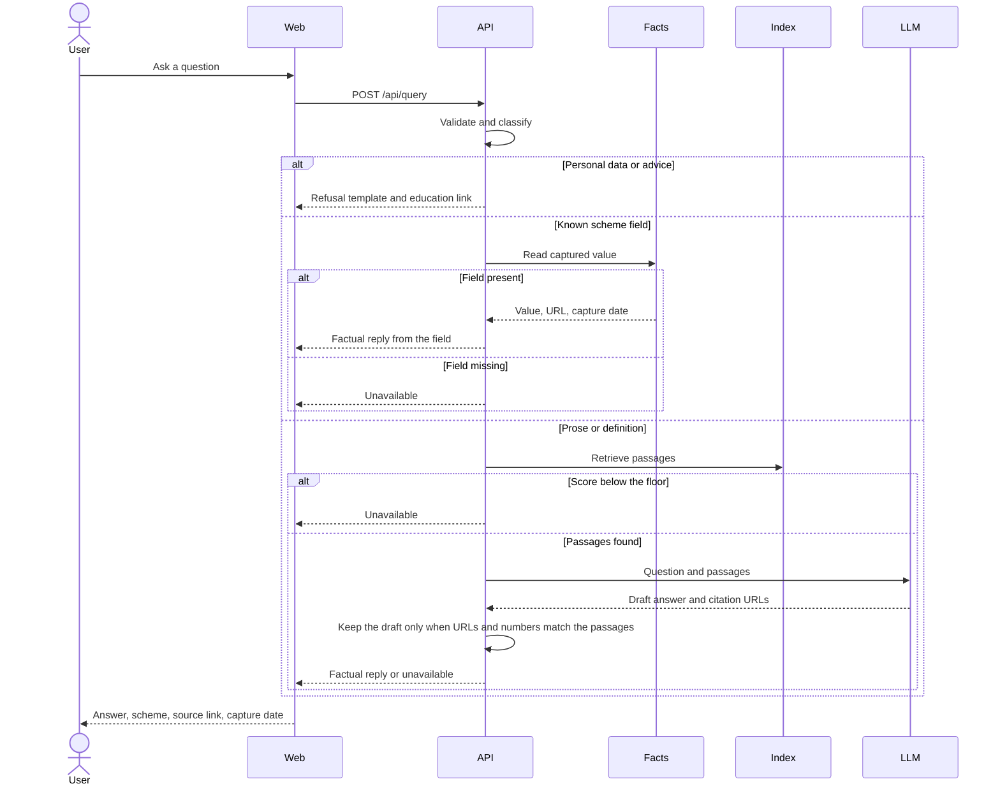

# Architecture

Facts-only mutual fund FAQ assistant. A fixed HDFC corpus is ingested into structured scheme facts and a passage index. A question is classified first. Personal-data and advice questions receive a fixed refusal. Scheme facts are read from the structured store. Explanations and procedures are written from retrieved passages and checked against those passages before they are shown.

This document is the build plan for the workflow in [problemStatement.md](problemStatement.md).

## 1. Goals

The application must:

- Answer factual questions about five HDFC Mutual Fund schemes listed on Groww.
- Answer general definition and process questions that the corpus covers, including expense ratio, riskometer, ELSS lock-in, and downloading a capital gains or account statement.
- Ground every factual reply in corpus text, with the scheme name, a source link, and the date that source was captured.
- Prefer an AMC, SEBI, or AMFI URL when that page and a Groww page state the same fact.
- Refuse investment advice, opinions, return predictions, and questions that contain personal data, without calling a model.
- Say when the corpus does not contain the fact.

## 2. Constraints that shape the design

The scheme set is closed. These five pages are required corpus entries:

| Scheme id | Scheme | Groww page |
| --- | --- | --- |
| `hdfc-mid-cap` | HDFC Mid Cap Fund Direct Growth | https://groww.in/mutual-funds/hdfc-mid-cap-fund-direct-growth |
| `hdfc-small-cap` | HDFC Small Cap Fund Direct Growth | https://groww.in/mutual-funds/hdfc-small-cap-fund-direct-growth |
| `hdfc-large-cap` | HDFC Large Cap Fund Direct Growth | https://groww.in/mutual-funds/hdfc-large-cap-fund-direct-growth |
| `hdfc-silver-etf-fof` | HDFC Silver ETF FoF Direct Growth | https://groww.in/mutual-funds/hdfc-silver-etf-fof-direct-growth |
| `hdfc-multi-cap` | HDFC Multi Cap Fund Direct Growth | https://groww.in/mutual-funds/hdfc-multi-cap-fund-direct-growth |

None of the five is an ELSS scheme. An ELSS lock-in question is answered from a regulatory or education page as a general rule. A lock-in question about one of these schemes is answered from that scheme’s category and exit load. The three-year ELSS rule is not applied to them.

Groww scheme pages publish the labeled facts this product needs, and they also publish material the product must not answer from:

| On the page | Treatment |
| --- | --- |
| Expense ratio, exit load, minimum SIP, minimum lump sum, risk label, category, benchmark, investment objective, fund manager, NAV with date, fund size | Stored as structured fields and used for answers |
| Stamp duty and the page’s general tax note | Stored and used only for “what does the page state” questions |
| Return calculator, annualised returns, rank tables, and “would have become” projections | Left out of the index. Questions about returns, rank, or outperformance are refused |
| Holdings table | Stored separately and used only when the user asks for holdings |
| “About” paragraph | Left out of the index. On the mid-cap page it restates figures that disagree with the labeled fund size. Labeled fields win |

NAV, expense ratio, and fund size change. The assistant reports the value captured at ingest and the capture date. It does not recompute NAV, historical returns, or tax for a person.

Additional corpus pages are AMC factsheets and scheme information documents for these five schemes, plus SEBI, AMFI, and Groww help or learn articles. Their URLs live in `sources.yaml`. A request cannot add a URL.

## 3. Design principles

1. **Classify before retrieval.** Personal data and advice never reach the embedder, the vector store, or the model. The reply is a fixed template.
2. **Numbers come from structured fields.** Expense ratio, exit load, minimums, NAV, fund size, riskometer, benchmark, and category are filled from the ingest extract. The model is not asked to recall or rephrase them.
3. **The passage index is for prose.** Investment objective, fund-manager biography, definitions, and statement-download steps are retrieved, then written up from those passages.
4. **A generated sentence must be supported by the passages just retrieved.** Every number and every citation URL in a generated answer has to appear in that context. A failed check becomes an unavailable reply.
5. **Official pages outrank platform pages.** When the same field was extracted from an AMC, SEBI, or AMFI document and from Groww, the citation is the official URL.
6. **The corpus is refreshed by a command, not by a user question.** Query handling reads the last successful index only.

## 4. System context



Public websites are an ingest-time dependency. `scripts/ingest.py` fetches the allowlisted URLs, writes the facts file and the passage index, and exits. A user question does not fetch Groww, the AMC, SEBI, or AMFI.

## 5. Runtime components



| Component | Responsibility |
| --- | --- |
| Disclaimer banner | States that answers are public facts from the last corpus refresh and are not investment advice. It stays visible. |
| Request validation | Rejects an empty question and a question longer than 500 characters. |
| Classifier | Labels the question `pii`, `advisory`, or `factual` with rules. `pii` and `advisory` stop the pipeline. |
| Scheme and field resolver | Maps aliases to one or two scheme ids and maps the question to a known field, a holdings request, a general topic, or prose. |
| Scheme facts | Returns the captured value, source URL, authority, and capture date for a field. |
| Passage retrieval | Embeds the question, filters by scheme and topic when those are known, and returns the top passages above a score floor. |
| Prompt builder | Sends the question and the retrieved passages. Instructions limit the draft to those passages. |
| LLM client | Calls an OpenAI-compatible chat endpoint with a JSON schema, temperature 0, and a timeout. The key stays on the server. |
| Answer guard | Checks citation URLs and numbers against the retrieved passages. A failed check yields an unavailable reply. |
| Response assembler | Builds one payload shape for factual, refusal, and unavailable replies. |

## 6. Request lifecycle



Refusal and structured-fact replies do not wait on a model. Prose replies are dominated by the model call. Ingest is outside this path.

## 7. Data architecture

### 7.1 Corpus file

`backend/data/sources.yaml` is the allowlist. Each entry has:

| Field | Purpose |
| --- | --- |
| `url` | Page to fetch |
| `document_type` | `scheme_page`, `factsheet`, `sid`, `regulatory`, or `help` |
| `authority` | `official` for AMC, SEBI, and AMFI. `platform` for Groww |
| `scheme_id` | One of the five ids, or empty for a general page |
| `topic` | Optional hint such as `elss_lock_in` or `capital_gains_statement` |

The five Groww URLs are required entries with `document_type: scheme_page`, `authority: platform`, and the matching `scheme_id`. Ingest fails if any required URL is missing from the file.

Hosts the fetcher may call:

- `groww.in`
- `www.hdfcfund.com`
- `www.sebi.gov.in`
- `investor.sebi.gov.in`
- `www.amfiindia.com`

A Scheme Information Document link found on a fetched scheme page may be fetched in the same run when its host is on this list. The crawl stops after that one hop. Help and regulatory URLs that are not linked from the scheme pages are added by editing `sources.yaml`.

### 7.2 Ingest

`scripts/ingest.py` runs offline:

1. Read `sources.yaml` and reject any URL whose host is not allowlisted.
2. Fetch each URL once, at most one request per second, with a 20-second timeout and a descriptive user agent. Store the raw body under `data/raw/` keyed by a hash of the URL.
3. Record `accessed_at` as the UTC date of that fetch. A failed fetch is written to the manifest as `failed` and does not delete the previous good record for that URL.
4. For an HTML scheme page, read labeled facts from the page’s embedded data when present, otherwise from label-value text in the main content. Map labels to the fields in the next section.
5. For a PDF factsheet or SID, extract text. A PDF with no text layer is marked `failed`.
6. Write one passage per prose field. On a Groww scheme page those fields are the investment objective (`description`), the tax note (`category_info.tax_impact`), the stamp-duty line, and each current fund manager’s name, education, and experience. Prefix the heading onto a short field. Do not merge fields toward 500 tokens and do not overlap them. If a passage exceeds 400 tokens, split it with a small overlap so it stays under the embedding model’s 512-token limit. Fixture HTML has no embedded JSON; there, one passage per heading uses the same metadata and the same exclusions. Attach metadata to every passage.
7. Embed passages with the local model named in configuration and replace that URL’s rows in the vector collection.
8. Write `data/scheme_facts.json` and `data/manifest.json`. The query process loads these files and does not modify them.

Passage metadata:

| Field | Purpose |
| --- | --- |
| `source_url` | Citation target |
| `title` | Source title |
| `authority` | `official` or `platform` |
| `document_type` | From the catalog entry |
| `scheme_id` | Scheme, or empty for a general document |
| `topic` | `objective`, `fund_manager`, `definition`, `statement_download`, `tax_note`, `stamp_duty`, or `other` |
| `accessed_at` | Capture date |
| `as_of` | Date printed on the page, when one is present |

Do not write passages for return tables, rank tables, calculator output, the About paragraph, holdings, peer comparisons, return commentary, expense history, old exit-load schedules, other schemes a manager also runs, the fund-house blurb, or the category-info description. On the captured Groww pages that category-info block describes a contra fund for schemes that are not contra funds.

### 7.3 Scheme fact record

One object per scheme in `scheme_facts.json`:

| Field | Typical source label on Groww |
| --- | --- |
| `scheme_id`, `name` | Registry |
| `category` | Category chips, such as Equity and Mid Cap |
| `riskometer` | Risk label beside the name |
| `expense_ratio` | Expense ratio |
| `exit_load` | Exit load |
| `minimum_sip` | Min. for SIP |
| `minimum_lumpsum` | Min. for 1st investment |
| `minimum_additional` | Min. for 2nd investment |
| `nav_value`, `nav_date` | NAV line |
| `aum` | Fund size (AUM) |
| `benchmark` | Fund benchmark |
| `fund_manager` | Current fund manager sentence |
| `stamp_duty` | Stamp duty line |
| `tax_note` | Tax implication block |
| `holdings` | Top 10 rows of the holdings table: name, sector, weight |
| `source_url` | Page the value was taken from |
| `authority` | `platform` or `official` |
| `accessed_at` | Capture date |
| `sid_url` | SID link when the host is allowlisted |

A missing label stays null for that scheme. The silver ETF FoF page is not assumed to use the same exit-load sentence as the equity funds.

When an official document and the Groww page both produce the same field, keep both values only long enough to compare them. Persist the official value and URL when the normalized values match. When they differ, persist the official value, set `conflict: true`, and keep the Groww value on `platform_value` for the manifest. The spoken answer uses the official value. The UI can show that the sources differ. The assistant does not average them.

### 7.4 Passage index

Chroma collection `scheme_passages`, persisted on disk, cosine distance. Embedding model: `BAAI/bge-small-en-v1.5`, run locally (384 dimensions, 512-token context). Questions are embedded with the prefix `Represent this sentence for searching relevant passages: `; passages are not. The scheme pages yield a few dozen short passages, so retrieval is a metadata filter plus cosine distance, not a large ANN corpus. The manifest stores the model name and the collection count. The API refuses to serve if the loaded model name differs from the manifest, because vectors from another model are not comparable.

General documents use an empty `scheme_id`. Metadata values are strings so the filter syntax stays uniform.

### 7.5 Loading

On startup the API reads `scheme_facts.json` and `manifest.json`, opens the Chroma directory, and checks the embedding-model name. A missing facts file or an empty collection fails startup with a log line that points at `scripts/ingest.py`.

## 8. Question handling

### 8.1 Classifier

Rules run in this order. The first match wins. The model is not used to classify.

**Personal data.** Refuse when the question contains any of:

- A PAN-shaped token
- A 12-digit Aadhaar-shaped number
- An email address
- A 10-digit phone number
- An OTP mentioned together with digits

The refusal asks the user to remove that identifier and ask the factual question again. The raw question is not written to logs. The reply does not echo the identifier.

**Advice.** Refuse when the question asks for a recommendation, a ranking, a prediction, a portfolio, a personal tax outcome, or market timing. Phrases that match include “should I”, “which is better”, “which fund”, “best fund”, “recommend”, “outperform”, “CAGR”, “returns”, “how much will I”, “how much should I invest”, “portfolio”, “good time”, “worth buying”, and “for my risk”. A question that only names a published field, such as “exit load” or “expense ratio”, stays factual.

**Factual.** Everything else proceeds.

“Is the expense ratio good?” is advice because of “good”. “What is the expense ratio of HDFC Mid Cap?” is factual.

### 8.2 Scheme resolution

Aliases are matched case-insensitively:

| Scheme id | Aliases |
| --- | --- |
| `hdfc-mid-cap` | hdfc mid cap, mid cap, midcap |
| `hdfc-small-cap` | hdfc small cap, small cap, smallcap |
| `hdfc-large-cap` | hdfc large cap, large cap, largecap |
| `hdfc-silver-etf-fof` | silver etf, silver fof, silver |
| `hdfc-multi-cap` | hdfc multi cap, multi cap, multicap |

“Cap fund” alone matches more than one scheme, so it resolves to none. More than two matched schemes is treated as ambiguous.

The client may send `priorSchemeId` from the previous factual reply. It is used only when the new question names no scheme. Example: after a mid-cap expense-ratio answer, “and the exit load?” reads the mid-cap exit load. `priorSchemeId` is not evidence and is not sent to the model as a fact.

### 8.3 Field resolution

| Question intent | Handler |
| --- | --- |
| Expense ratio, exit load, minimum SIP, minimum lump sum, riskometer, benchmark, category, NAV, fund size, fund manager name | Structured field. One scheme is required. Zero schemes returns a clarification that lists the five names. Two schemes returns two facts and two citations, with no comparative language. |
| Investment objective, who the manager is in more detail | Passages filtered to that `scheme_id` and topic |
| Top holdings | Structured `holdings`, capped at 10, one scheme required |
| What is an expense ratio, riskometer, or exit load, with no scheme | Passages with an empty `scheme_id` and topic `definition` |
| ELSS lock-in, with no scheme | Passages tagged `elss_lock_in` |
| Lock-in of one of the five schemes | Structured category and exit load. The reply states the scheme’s category and exit load. |
| How to download a capital gains statement or account statement | Passages with topic `statement_download` and an empty `scheme_id` |
| Tax a specific person owes, or tax on “my” gains | Refusal, even if a scheme is named |
| What tax note the scheme page prints | Structured `tax_note`, plus a sentence that this is the page’s general description |

### 8.4 Retrieval

Used only for the prose rows above.

1. Embed the question with the same model as ingest, including the retrieval prefix from section 7.4. Passages were embedded without that prefix.
2. If a scheme was resolved, filter to that `scheme_id`. Definition and statement questions filter to an empty `scheme_id`.
3. If a topic was resolved, filter to that topic.
4. Take the top 4 passages.
5. Drop the set when the best distance is worse than the configured floor. The floor is a constant in `config.py`, chosen from the evaluation questions so known facts pass and an unrelated question fails.
6. Sort the surviving passages so `authority: official` comes before `authority: platform`.

A weak set does not call the model.

### 8.5 Structured answer template

The reply is a sentence filled from the record, not a model draft:

> The expense ratio of HDFC Mid Cap Fund Direct Growth is 0.74%. Last updated from sources: 2026-10-31.

NAV replies include `nav_date` as well as `accessed_at`. Two-scheme replies are two such sentences. Words such as “better”, “recommend”, and “should” are not part of the template.

Citation selection:

1. Use the official URL when `authority` is `official`.
2. Otherwise use the Groww scheme URL stored on the record.

### 8.6 Prompt contract

Used for prose only. Temperature is 0.

System instructions:

- Write two to four sentences using only the supplied passages.
- If the passages do not contain the fact, set `grounded` to false and leave `answer` empty.
- Do not add a number, date, or name that is not in the passages.
- Do not recommend a scheme or describe expected performance.
- Cite `source_url` values from the passages only.
- Respond with JSON only.

User message: the question, and each passage as `source_url`, `accessed_at`, `authority`, and text.

Response schema:

```json
{
  "grounded": true,
  "answer": "string",
  "citation_urls": ["string"]
}
```

### 8.7 Answer guard

- `grounded: false`, an empty answer, or unparseable JSON becomes an unavailable reply.
- Every `citation_urls` entry must be one of the retrieved `source_url` values. Other URLs are dropped. Zero surviving URLs becomes unavailable.
- Every number in the answer, including percentages and rupee amounts, must appear in the concatenated passage text. A missing number becomes unavailable.
- The answer is length-capped before it reaches the client.
- The primary citation is the first surviving official URL, otherwise the first surviving URL. `accessed_at` comes from that passage.

### 8.8 Unavailable and refusal copy

Unavailable:

> I don’t have that in the sources for this assistant. Check the scheme page on Groww or the HDFC Mutual Fund documents for this scheme.

The reply includes the relevant Groww scheme URL when a scheme was resolved, so the user has a place to look. It does not include a guessed number.

Advisory refusal:

> I can only share factual information from public sources. I can’t recommend a scheme, compare which one is better, or predict returns. For investor education, see the AMFI investor page.

Personal-data refusal:

> Please remove identity or account details from your question and ask it again. This assistant does not read PAN, Aadhaar, phone numbers, email addresses, or OTPs.

Education links are configuration, not model output:

- https://www.amfiindia.com/investor
- https://investor.sebi.gov.in/
- https://groww.in/learn/mutual-funds

## 9. API

Base path `/api`. JSON in and out.

### `GET /api/health`

Returns process status, scheme count, passage count, embedding model name, and the oldest `accessed_at` in the manifest.

### `GET /api/schemes`

Returns the five schemes for suggestion chips: `scheme_id`, display name, and Groww URL. Values such as expense ratio are not included here. They are answered through `/api/query` so every number on screen has come through the reply path.

### `POST /api/query`

Request:

```json
{
  "question": "What is the expense ratio of HDFC Mid Cap Fund?",
  "priorSchemeId": "hdfc-mid-cap"
}
```

`priorSchemeId` is optional and must be one of the five ids or omitted.

Factual success:

```json
{
  "responseType": "factual",
  "queryType": "factual",
  "answer": "The expense ratio of HDFC Mid Cap Fund Direct Growth is 0.74%. Last updated from sources: 2026-10-31.",
  "scheme": {
    "id": "hdfc-mid-cap",
    "name": "HDFC Mid Cap Fund Direct Growth"
  },
  "citations": [
    {
      "url": "https://groww.in/mutual-funds/hdfc-mid-cap-fund-direct-growth",
      "title": "HDFC Mid Cap Fund Direct Growth",
      "authority": "platform",
      "accessedAt": "2026-10-31",
      "asOf": "2026-10-30"
    }
  ]
}
```

`scheme` is null for a general definition or a statement-download answer. Two-scheme answers set `scheme` to null and put both names in the answer text, with one citation object per scheme.

Refusal (`200`):

```json
{
  "responseType": "refusal",
  "queryType": "advisory",
  "answer": "I can only share factual information from public sources. I can’t recommend a scheme, compare which one is better, or predict returns. For investor education, see the AMFI investor page.",
  "scheme": null,
  "citations": [
    {
      "url": "https://www.amfiindia.com/investor",
      "title": "AMFI investor education",
      "authority": "official",
      "accessedAt": null,
      "asOf": null
    }
  ]
}
```

`queryType` is `pii` or `advisory`.

Unavailable (`200`):

```json
{
  "responseType": "unavailable",
  "queryType": "factual",
  "answer": "I don’t have that in the sources for this assistant. Check the scheme page on Groww or the HDFC Mutual Fund documents for this scheme.",
  "scheme": {
    "id": "hdfc-silver-etf-fof",
    "name": "HDFC Silver ETF FoF Direct Growth"
  },
  "citations": [
    {
      "url": "https://groww.in/mutual-funds/hdfc-silver-etf-fof-direct-growth",
      "title": "HDFC Silver ETF FoF Direct Growth",
      "authority": "platform",
      "accessedAt": "2026-10-31",
      "asOf": null
    }
  ]
}
```

Clarification (`200`, still `responseType: unavailable`) lists the five scheme names when a field question names no scheme and `priorSchemeId` is empty. `queryType` is `factual`.

Errors:

| Status | When |
| --- | --- |
| 422 | Empty question, question over 500 characters, or unknown `priorSchemeId` |
| 503 | Facts file or passage index is not loaded |

Provider failures on the prose path are unavailable replies with status 200. They are not 500s. A structured-fact question never depends on the provider.

## 10. Web client

A single chat page is enough.

**Chrome**

- A persistent disclaimer: this assistant shares public facts from HDFC scheme sources and does not give investment advice.
- The oldest capture date from `GET /api/health`, labeled “Sources last captured”.
- Suggestion chips for the five schemes and for a few known questions: expense ratio, exit load, minimum SIP, and how to download a capital gains statement.

**Composer**

- One text field and a submit control.
- The field disables while a request is in flight.
- The client sends `priorSchemeId` from the latest factual reply that had a scheme.

**Transcript**

- A factual message shows the answer, the scheme name when present, a link per citation, the authority, and “Last updated from sources” using `accessedAt`.
- A refusal message shows the template and the education links. It has no scheme facts beside it.
- An unavailable message shows the template and, when present, the scheme link.
- The client renders the payload. It does not call a model, rank schemes, or compute returns.

## 11. Suggested repository layout

```text
backend/
  app/
    main.py                     # FastAPI app, load facts and index
    api/
      health.py
      schemes.py
      query.py
    schemas/
      request.py
      response.py
      facts.py
    services/
      classify.py               # pii and advisory rules
      resolve.py                # scheme aliases and field intent
      facts.py                  # read scheme_facts.json
      retrieve.py               # embed, filter, score floor
      answer.py                 # templates for structured fields
      prompt.py
      llm_client.py
      guard.py                  # citation and number checks
      query_service.py          # classify, resolve, answer, or retrieve
    config.py                   # caps, score floor, model names, education URLs
  scripts/
    ingest.py
  data/
    sources.yaml                # allowlisted corpus, including the five Groww URLs
    scheme_facts.json           # generated
    manifest.json               # generated
    raw/                        # generated fetch bodies
    chroma/                     # generated index
  tests/
    test_classify.py
    test_resolve.py
    test_answer.py
    test_guard.py
    test_query_service.py
frontend/
  src/
    App.tsx
    api.ts
    components/Disclaimer.tsx
    components/Composer.tsx
    components/Transcript.tsx
problemStatement.md
architecture.md
```

## 12. Technology choices

| Concern | Choice | Why |
| --- | --- | --- |
| API | Python 3.11+ and FastAPI | Matches a typed JSON API and the ingest scripts |
| Validation | Pydantic | Same models for HTTP and the generation schema |
| Fetch | `httpx` | Timeouts and a single allowlisted client |
| HTML | Parse embedded page data, then labeled main-content text | Groww scheme pages expose the fields as labels. Navigation and return tables stay out of the index |
| PDF | `pypdf` | Factsheets and SIDs |
| Embeddings | `BAAI/bge-small-en-v1.5` via sentence-transformers | Runs locally, so ingest and retrieval need no embedding key. Passages are short English, inside the 512-token window. Questions use the model’s retrieval prefix. Cosine distance. |
| Vector store | Persistent Chroma, cosine space | About 20 to 30 scheme-page passages. Metadata filters on scheme and topic are what separate identical tax sentences. |
| LLM | Chat completions, JSON schema, model name in the environment | Used only for prose. Vendor stays out of classification and fact lookup |
| Web | React + Vite | Disclaimer, composer, and transcript |
| Config | Environment variables and `config.py` | Keys stay off the client. Score floor and caps stay in code review |

`LLM_BASE_URL` defaults to an OpenAI-compatible endpoint so a local model server can be used in development. Structured-field answers work with no key.

## 13. Configuration

| Variable | Required | Purpose |
| --- | --- | --- |
| `LLM_API_KEY` | Only for prose answers | Provider credential. Never committed or sent to the browser |
| `LLM_BASE_URL` | No | Compatible endpoint override |
| `LLM_MODEL` | No | Chat model id |
| `LLM_TIMEOUT_SECONDS` | No | Default 20 |
| `FACTS_PATH` | No | Path to `scheme_facts.json` |
| `CHROMA_PATH` | No | Path to the persistent index |
| `EMBEDDING_MODEL` | No | Default `BAAI/bge-small-en-v1.5` |

The score floor, the passage cap (`4`), the question length cap (`500`), the holdings cap (`10`), and the education URLs live in `config.py`.

## 14. Failure behavior

| Failure | Behavior |
| --- | --- |
| Facts file or index missing at startup | Process exits with a log line that points at `scripts/ingest.py` |
| Embedding model name ≠ manifest | Process exits. Re-run ingest with the configured model |
| One source fails during ingest | That URL is `failed` in the manifest. Previous facts for that URL remain. Other URLs still update |
| Required Groww URL missing from `sources.yaml` | Ingest exits before fetching |
| Fetch returns a login wall or empty main text | URL marked `failed`. No fact is invented |
| Question contains personal data or advice | 200 refusal. No retrieval and no model call |
| Field question with no scheme | 200 clarification listing the five schemes |
| Structured field is null | 200 unavailable, with the scheme URL when known |
| Retrieval below the score floor | 200 unavailable. No model call |
| Model timeout, HTTP error, or invalid JSON | 200 unavailable |
| Generated number or URL is not in the passages | 200 unavailable |
| Unknown `priorSchemeId` | 422 |

Log query type, scheme id, whether the reply was structured, retrieved, refused, or unavailable, and model latency when a model was called. Do not log the API key, a question classified as `pii`, or the full prompt at info level.

## 15. Testing

Classifier and guard tests do not download pages or call a provider.

- **Classifier.** PAN, email, phone, and OTP questions return `pii` and the logged text does not contain the identifier. “Should I invest”, “which is better”, “will this outperform”, and “how much tax will I pay” return `advisory`. “What is the exit load of HDFC Small Cap” returns `factual`.
- **Resolver.** Each alias maps to one scheme. “Cap fund” maps to none. “Mid cap and small cap expense ratio” maps to two schemes and the field `expense_ratio`. “What is a riskometer” maps to a definition with no scheme. “ELSS lock-in of HDFC Large Cap” uses category and exit load.
- **Structured answers.** A fixture fact record produces the template sentence, the official URL when `authority` is `official`, and the Groww URL otherwise. A null expense ratio returns unavailable. Two schemes produce two sentences and no “better”.
- **Guard.** A citation outside the retrieved set is dropped. A percentage absent from the passages makes the reply unavailable. `grounded: false` makes the reply unavailable.
- **Orchestration with a fake LLM client.** An advisory question does not call the fake. A field question does not call the fake. A prose question sends only the retrieved passage text. A client exception returns unavailable.
- **API.** 422 on an empty question. 200 shapes for factual, refusal, and unavailable against a fixture of two schemes.

The live provider and the live Groww fetch are outside the default test run. A separate ingest check, run manually, fetches the five Groww URLs and asserts each scheme has non-null `expense_ratio`, `exit_load`, `minimum_sip`, `riskometer`, and `benchmark` or an explicit null recorded in the manifest for that label.

## 16. Build order

1. Scheme registry, `sources.yaml` with the five Groww URLs, and fixture facts for tests.
2. Classifier, resolver, and structured answer templates. This path answers expense ratio, exit load, and minimum SIP before any model key or vector store exists.
3. Ingest for the five Groww pages: labeled-field extraction, exclusions for return tables, `scheme_facts.json`.
4. `POST /api/query` wired to classification and structured facts, plus refusal and unavailable copy.
5. Passage chunking, local embeddings, and Chroma, then definition and statement-download retrieval.
6. LLM client, prompt, and answer guard, with unavailable fallback.
7. Official-source entries in `sources.yaml` and citation preference.
8. Chat UI: disclaimer, suggestions, transcript, citation, and capture date.
9. Clarification when a field question names no scheme, and `priorSchemeId` for a follow-up.

## 17. Out of scope for this version

- Schemes other than the five HDFC pages in the registry
- Live NAV, return calculation, ranking, and tax computation for a person
- Accounts, portfolios, order placement, and saved chats on the server
- A scheduled crawler. Refresh is `scripts/ingest.py`
- Using a model to decide whether a question is advice
- Answering from the return calculator or from rank tables
- Memory of anything except the last resolved scheme id, supplied by the client
